<div align="center">


# 🤖 Agentic-RAG-IT-Support-System

An end-to-end **Forward Deployed Engineer (FDE) project** that turns a notebook-style Agentic RAG workflow into a deployable internal product using **LangGraph, FastAPI, Pinecone, Groq, Tavily, HTML, CSS, and JavaScript**.

<br/>


<br/>

[🧩 Business Problem](#1-business-problem) •
[🧭 FDE](#2-why-this-is-an-fde-project) •
[🏗️ Architecture](#3-simple-architecture) •
[🔀 Workflow](#4-agentic-rag-workflow) •
[🛠️ Stack](#5-main-technology-stack) •
[📁 Structure](#6-project-structure) •
[⚙️ Setup](#7-setup) •
[🎬 Demos](#8-classroom-demo-scenarios) •
[📤 Upload](#9-document-upload-demo) •
[🔌 API](#10-api-endpoints)

</div>

---

## 📑 Table of Contents

| # | Section | |
|---|---|---|
| 0 | [Creating the Virtual Environment](#-creating-the-virtual-environment) | 🐍 |
| 1 | [Business Problem](#1-business-problem) | 🧩 |
| 2 | [Why This Is an FDE Project](#2-why-this-is-an-fde-project) | 🧭 |
| 3 | [Simple Architecture](#3-simple-architecture) | 🏗️ |
| 4 | [Agentic RAG Workflow](#4-agentic-rag-workflow) | 🔀 |
| 5 | [Main Technology Stack](#5-main-technology-stack) | 🛠️ |
| 6 | [Project Structure](#6-project-structure) | 📁 |
| 7 | [Setup](#7-setup) | ⚙️ |
| 8 | [Classroom Demo Scenarios](#8-classroom-demo-scenarios) | 🎬 |
| 9 | [Document Upload Demo](#9-document-upload-demo) | 📤 |
| 10 | [API Endpoints](#10-api-endpoints) | 🔌 |

---

# 🐍 CREATING THE VIRTUAL ENVIRONMENT

```bash
conda create -n projectagenticrag python=3.11 -y

conda activate projectagenticrag


pip install -r requirements.txt
```

---

# 1. Business Problem 🧩

### 🏢 Customer
NovaRetail, a fictional 3,000-employee retail company.

## ❗ Problem

The internal IT team maintains many documents: VPN instructions, password rules, MFA policy, software installation rules, laptop troubleshooting guides, and service-desk runbooks.

Employees still create repetitive support tickets because:

- ❌ They do not know where the correct document is.
- ❌ Traditional keyword search returns too many results.
- ❌ A normal chatbot may hallucinate an answer.
- ❌ Internal documents can be incomplete or outdated.
- ❌ Some questions require current vendor information from the public web.

## 💡 Example
An employee asks:

### 1)How do I connect to the company VPN from home?

The answer exists in the private company KB, so the system should not search the public internet.

Another employee asks:

### 2)What is the latest Microsoft Teams outage guidance?”

The internal KB may not contain current outage information. The system should recognize weak private evidence, use an external search, grade that evidence, and answer with an external-source warning.

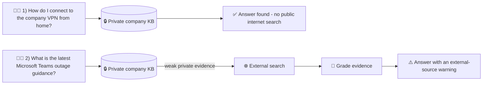

## 🎯 Business Goal
Build a secure IT Support Copilot that:

- 🔍 Searches trusted private knowledge first.
- ✅ Checks whether retrieved evidence is good enough.
- 🌐 Uses web search only when private knowledge is insufficient.
- ✍️ Rewrites weak queries and retries.
- 📚 Generates grounded answers.
- 🧭 Shows the decision path for transparency and debugging.
- 🔐 Lets authorized staff add new company documents.

---

# 2. Why This Is an FDE Project 🧭

A Forward Deployed Engineer does more than create an LLM notebook. The FDE must turn the customer's problem into a usable product.

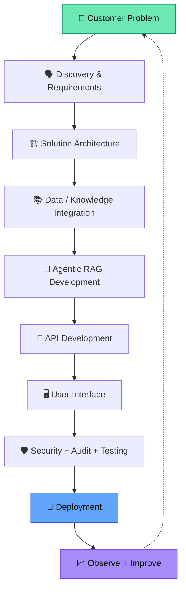

<details>
<summary>📜 Original text diagram</summary>

```text

Customer Problem
      ↓
Discovery & Requirements
      ↓
Solution Architecture
      ↓
Data / Knowledge Integration
      ↓
Agentic RAG Development
      ↓
API Development
      ↓
User Interface
      ↓
Security + Audit + Testing
      ↓
Deployment
      ↓
Observe + Improve
This repository demonstrates each layer.
```

</details>

This repository demonstrates each layer.

---


## 3. Simple Architecture 🏗️

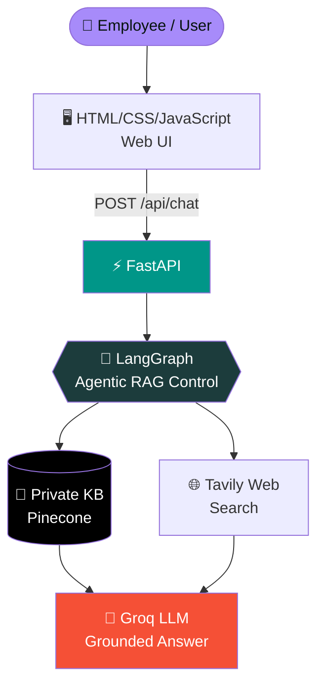

<details>
<summary>📜 Original text diagram</summary>

```text
                   ┌─────────────────────┐
                   │   Employee / User   │
                   └──────────┬──────────┘
                              │
                              ▼
                   ┌─────────────────────┐
                   │ HTML/CSS/JavaScript │
                   │      Web UI         │
                   └──────────┬──────────┘
                              │ POST /api/chat
                              ▼
                   ┌─────────────────────┐
                   │       FastAPI       │
                   └──────────┬──────────┘
                              │
                              ▼
                   ┌─────────────────────┐
                   │     LangGraph       │
                   │ Agentic RAG Control │
                   └──────────┬──────────┘
                              │
               ┌──────────────┴──────────────┐
               │                             │
               ▼                             ▼
       ┌───────────────┐              ┌──────────────┐
       │ Private KB    │              │ Tavily Web   │
       │ Pinecone      │              │ Search       │
       └───────┬───────┘              └──────┬───────┘
               │                             │
               └──────────────┬──────────────┘
                              ▼
                     ┌────────────────┐
                     │ Groq LLM       │
                     │ Grounded Answer│
                     └────────────────┘
```

</details>

---

## 4. Agentic RAG Workflow 🔀

This follows the same core implementation pattern as the reference notebook.

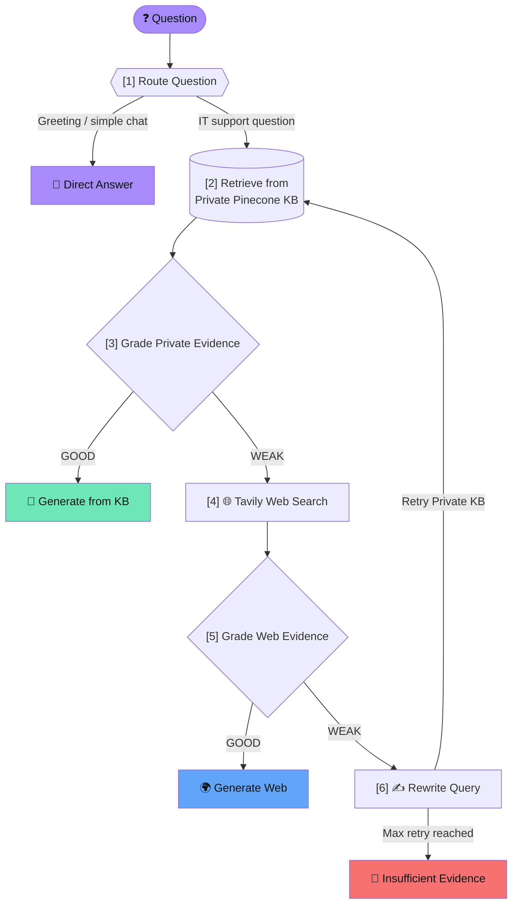

<details>
<summary>📜 Original text diagram</summary>

```text
Question
   ↓
[1] Route Question
   ├── Greeting / simple chat ─────────────→ Direct Answer
   │
   └── IT support question
                ↓
[2] Retrieve from Private Pinecone KB
                ↓
[3] Grade Private Evidence
       ┌────────┴────────┐
       │                 │
     GOOD               WEAK
       │                 │
       ▼                 ▼
Generate from KB    [4] Tavily Web Search
                         ↓
                  [5] Grade Web Evidence
                    ┌────┴─────┐
                    │          │
                  GOOD        WEAK
                    │          │
                    ▼          ▼
              Generate Web  [6] Rewrite Query
                               ↓
                         Retry Private KB
                               ↓
                        Max retry reached?
                               ↓
                    Insufficient Evidence
```

</details>

### 🧠 Why Agentic?

Normal RAG does approximately this:

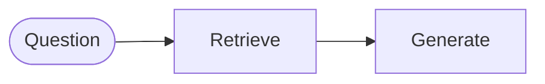

```text
Question → Retrieve → Generate
```

This project makes decisions:

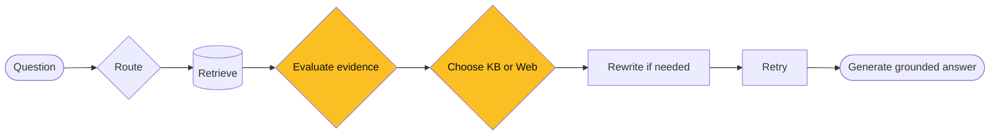

```text
Question
 → Route
 → Retrieve
 → Evaluate evidence
 → Choose KB or Web
 → Rewrite if needed
 → Retry
 → Generate grounded answer
```

The system therefore controls **what to do next** based on its current state.

---

## 5. Main Technology Stack 🛠️

| Layer | Technology | Purpose |
|---|---|---|
| 🧠 Agent workflow |  | Stateful routing and conditional decisions |
| 🤖 LLM |  | Routing, grading, rewriting, answer generation |
| 🔢 Embeddings |  `all-MiniLM-L6-v2` | Local 384-dimensional embeddings |
| 🌲 Vector DB |  | Private enterprise knowledge base |
| 🌐 External search |  | Fallback when company KB is insufficient |
| ⚡ API |  | Backend and REST endpoints |
| 🖥️ Frontend |  | Employee-facing interface |
| 🧾 Audit |  | Basic decision-path logging |
| 📦 Packaging |  | Reproducible deployment |

---

## 6. Project Structure 📁

```text
FDE_Agentic_RAG_IT_Copilot/
│
├── app/
│   ├── api/
│   │   └── routes.py              # Chat, health and ingestion APIs
│   │
│   ├── core/
│   │   ├── config.py              # Environment configuration
│   │   └── logging.py             # Logging configuration
│   │
│   ├── rag/
│   │   ├── state.py               # LangGraph state + structured decisions
│   │   ├── vectorstore.py         # Pinecone + embeddings
│   │   └── workflow.py            # Complete Agentic RAG graph
│   │
│   ├── services/
│   │   ├── audit.py               # SQLite query audit
│   │   └── ingestion.py           # PDF/TXT/MD/DOCX loading + chunking
│   │
│   └── main.py                    # FastAPI application
│
├── data/
│   └── sample_kb/
│       ├── company_it_handbook.md
│       └── service_desk_runbook.md
│
├── static/
│   ├── css/style.css
│   └── js/app.js
│
├── templates/
│   └── index.html
│
├── tests/
│   └── test_ingestion.py
│
├── uploads/
├── .env.example
├── Dockerfile
├── ingest_sample_kb.py
├── requirements.txt
├── run.py
└── README.md
```

---

## 7. Setup ⚙️

### Step 1 — Create virtual environment 🐍

```bash
python -m venv venv
```

Windows:

```bash
venv\Scripts\activate
```

macOS/Linux:

```bash
source venv/bin/activate
```

### Step 2 — Install dependencies 📦

```bash
pip install -r requirements.txt
```

### Step 3 — Configure environment 🔑

Create a `.env` file in the project root directory with the following variables:

```env
# LLM API Keys
GROQ_API_KEY=your_groq_api_key_here
OPENAI_API_KEY=your_openai_api_key_here

# External Search
TAVILY_API_KEY=your_tavily_api_key_here

# Vector Database (Pinecone)
PINECONE_API_KEY=your_pinecone_api_key_here
PINECONE_INDEX_NAME=fde-it-support-rag
PINECONE_NAMESPACE=company-it-kb

# LLM Models
GROQ_MODEL=openai/gpt-oss-20b
OPENAI_MODEL=gpt-4o-mini
EMBEDDING_MODEL=text-embedding-3-small

# Security
ADMIN_API_KEY=change-me-in-production

# Application Settings
APP_ENV=development
```

#### Environment Variable Reference

| Variable | Description | Example | Required |
|---|---|---|---|
| `GROQ_API_KEY` | API key for Groq LLM (routing, grading, generation) | `gsk_...` | ✅ Yes |
| `OPENAI_API_KEY` | API key for OpenAI (embeddings and fallback LLM) | `sk-...` | ✅ Yes |
| `TAVILY_API_KEY` | API key for Tavily web search | `tvly-...` | ✅ Yes |
| `PINECONE_API_KEY` | API key for Pinecone vector database | `pckey-...` | ✅ Yes |
| `PINECONE_INDEX_NAME` | Pinecone index name | `fde-it-support-rag` | ⚠️ Optional (default: `fde-it-support-rag`) |
| `PINECONE_NAMESPACE` | Pinecone namespace for document isolation | `company-it-kb` | ⚠️ Optional (default: `company-it-kb`) |
| `GROQ_MODEL` | Groq model identifier | `openai/gpt-oss-20b` | ⚠️ Optional (default: `openai/gpt-oss-20b`) |
| `OPENAI_MODEL` | OpenAI model identifier | `gpt-4o-mini` | ⚠️ Optional (default: `gpt-4o-mini`) |
| `EMBEDDING_MODEL` | Embedding model for vectorization | `text-embedding-3-small` | ⚠️ Optional (default: `text-embedding-3-small`) |
| `ADMIN_API_KEY` | Secret key for admin endpoints (document ingestion) | `your-secure-key` | ⚠️ Optional (default: `change-me`) |
| `APP_ENV` | Application environment | `development` or `production` | ⚠️ Optional (default: `development`) |

> [!WARNING]
> **⚠️ Important Security Notes:**
>
> - Never commit `.env` to version control. Add it to `.gitignore`.
> - Change `ADMIN_API_KEY` to a secure random value in production.
> - Use environment variables instead of hardcoding secrets.
> - Restrict API key access to only the services that need them.

### Step 4 — Load sample company knowledge 📚

```bash
python ingest_sample_kb.py
```

This demonstrates the RAG ingestion pipeline:

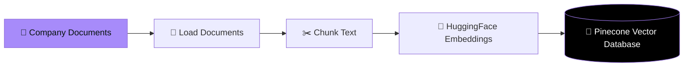

```text
Company Documents
   ↓
Load Documents
   ↓
Chunk Text
   ↓
HuggingFace Embeddings
   ↓
Pinecone Vector Database
```

### Step 5 — Run the application 🚀

```bash
python run.py
```

Open:

```text
http://127.0.0.1:8000
```

FastAPI API docs:

```text
http://127.0.0.1:8000/docs
```

---

## 8. Classroom Demo Scenarios 🎬

### Demo A — Private KB Success ✅

Ask:

> **How do I connect to the company VPN from home?**

Expected path:

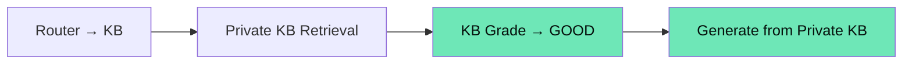

```text
Router → KB
Private KB Retrieval
KB Grade → GOOD
Generate from Private KB
```

Teaching point:

> Trusted internal company knowledge is preferred. No public web call is necessary.

---

### Demo B — Company Policy Question 🔐

Ask:

> **Can IT support ask me to share my MFA code?**

The internal handbook says employees must never share passwords or MFA codes with support personnel.

Expected path:

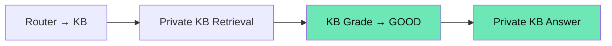

```text
Router → KB
Private KB Retrieval
KB Grade → GOOD
Private KB Answer
```

Teaching point:

> RAG allows the model to answer using company-specific information it was never trained on.

---

### Demo C — External / Current Information 🌐

Ask:

> **What is the latest Microsoft Teams outage guidance?**

Expected path when internal documents do not answer it:

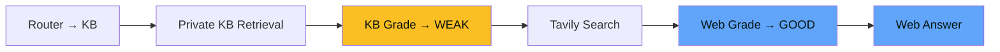

```text
Router → KB
Private KB Retrieval
KB Grade → WEAK
Tavily Search
Web Grade → GOOD
Web Answer
```

Teaching point:

> Agentic RAG can choose another information source rather than blindly answering from irrelevant vectors.

---

### Demo D — Query Rewrite ✍️

Ask a deliberately vague question such as:

> **My work communication app is acting strange after the new update. What should I do?**

If both KB and first external retrieval are weak, the workflow can rewrite the query and retry.

Teaching point:

> Retrieval failure does not immediately mean failure. An agent can improve the search query and try again while using a retry guard to avoid loops.

---

### Demo E — Direct Conversation 💬

Ask:

> **Hello!**

Expected path:

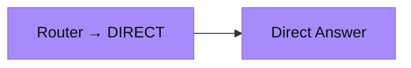

```text
Router → DIRECT
Direct Answer
```

Teaching point:

> Not every message should trigger expensive vector search or web search.

---

## 9. Document Upload Demo 📤

The sidebar contains **Add Company Document**.

Use the `ADMIN_API_KEY` from `.env`.

Upload one of:

- 📕 `.pdf`
- 📄 `.txt`
- 📝 `.md`
- 📘 `.docx`

The backend performs:

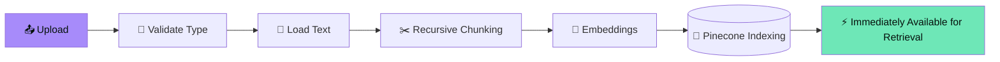

```text
Upload
  ↓
Validate Type
  ↓
Load Text
  ↓
Recursive Chunking
  ↓
Embeddings
  ↓
Pinecone Indexing
  ↓
Immediately Available for Retrieval
```

This is useful in an FDE demonstration because the customer does not want to edit Python every time a new policy is published.

---

## 10. API Endpoints 🔌

### 🟢 `GET /api/health`

Health check.

### 🔵 `POST /api/chat`

Request:

```json
{
  "question": "How do I reset my company password?"
}
```

Response contains:

```json
{
  "answer": "...",
  "source_used": "private_kb",
  "trace": [
    "Router → KB",
    "Private KB retrieval → 4 chunks",
    "KB evidence grade → GOOD",
    "Answer generation → PRIVATE KB"
  ],
  "citations": []
}
```

### 🟠 `POST /api/ingest`

Protected by the `X-Admin-Key` request header.

Uploads a document and adds its chunks to Pinecone.

---

<div align="center">


</div>
